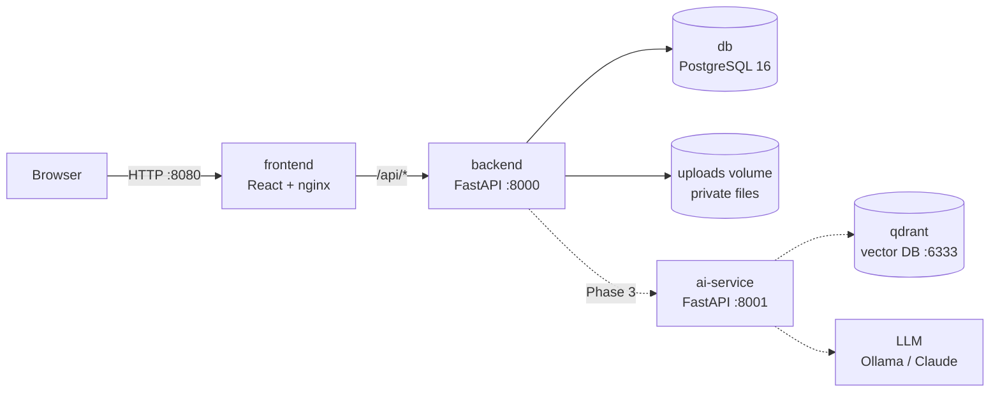

# DocVerify AI

[](https://github.com/Tejassonawane16/docverify-ai/actions/workflows/ci.yml)

AI-assisted verification of university application documents (degree certificates, transcripts,
language certificates, ID documents). Applicants upload documents, the AI service checks them
against a knowledge base of admission rules (Phase 3), and a human reviewer always makes the final
decision.

- **Product backlog:** [GitHub Project](https://github.com/users/Tejassonawane16/projects/3)
- **Product Definition (Phase 1):** user stories US-01 – US-22, personas and MoSCoW feature list
- **Sprint documentation:** [`docs/sprints`](docs/sprints)

## Status

| Phase | Content | State |
|---|---|---|
| 1 | Product definition, personas, user stories | ✅ done |
| 2 | Core system, Docker, CI/CD, Git workflow | ✅ this release |
| 3 | AI integration: OCR, RAG, prompts | planned |
| 4 | Evaluation and testing | planned |
| 5 | Final documentation and video | planned |

## Architecture



| Service | Technology | Responsibility |
|---|---|---|
| `frontend` | React 18, Vite, nginx | UI for applicants, reviewers and admins; proxies `/api` to the backend |
| `backend` | Python 3.12, FastAPI, SQLAlchemy | Authentication (JWT), roles, uploads, review decisions, audit log |
| `db` | PostgreSQL 16 | Users, documents, decisions, audit log |
| `qdrant` | Qdrant 1.12 | Vector database for the RAG knowledge base (used from Phase 3) |
| `ai-service` | Python 3.12, FastAPI | Separate, configurable AI service (stub in Phase 2, full RAG pipeline in Phase 3) |

## Quick start

Requirements: [Docker Desktop](https://www.docker.com/products/docker-desktop/) (includes Docker Compose) and Git.

```bash
git clone https://github.com/Tejassonawane16/docverify-ai.git
cd docverify-ai
cp .env.example .env        # Windows PowerShell: copy .env.example .env
docker compose up --build
```

Then open:

| URL | What |
|---|---|
| http://localhost:8080 | DocVerify AI web app |
| http://localhost:8000/docs | Interactive API documentation (Swagger UI) |
| http://localhost:6333/dashboard | Qdrant dashboard |

**First login:** the backend creates an admin account on first start from `ADMIN_EMAIL` /
`ADMIN_PASSWORD` in `.env` (default `admin@docverify.local` / `ChangeMe-Admin-123`).
Change these values before using the system for anything real.

Try the main flow:

1. Open http://localhost:8080 and **create an applicant account**, then upload a PDF, JPG or PNG.
2. In a private window, log in as **admin** → *Users* → create a **Reviewer** account.
3. Log in as the reviewer → *Review queue* → open the document → save a decision with a comment.
4. Back as the applicant: the new status and the reviewer's message are shown; a corrected version can be uploaded.
5. As admin, check the *Audit log*.

Stop with `Ctrl+C`, or `docker compose down`. Add `-v` to also delete the database and uploaded files.

## Features in this release (Phase 2)

| Feature | User stories |
|---|---|
| Registration, login, logout (JWT, bcrypt hashes, lockout after 5 failed attempts in 10 min, token deny-list on logout) | US-01, US-02 |
| Roles Applicant / Reviewer / Admin, checked on every API request; role changes apply immediately | US-02, US-03 |
| Upload of PDF/JPG/PNG up to 10 MB, checked by extension **and** file signature, stored under random names in a private volume | US-04 |
| Per-document status for applicants; reviewer comments; corrected versions with history | US-05, US-06 |
| Reviewer dashboard with status filter, search and sorting (date, AI confidence) | US-13 |
| Detail view with the original document, report placeholder, decision history and earlier versions | US-14 |
| Final human decision (Verified / Needs more information / Rejected); comment required when rejecting or overriding the AI | US-15 |
| Admin: create staff accounts, change roles, deactivate users, statistics | US-03 |
| Read-only audit log with filters (logins, uploads, downloads, decisions, user changes) | US-19 |
| Account and data deletion for applicants (GDPR) | US-21 |

## Development

### Project structure

```
docverify-ai/
├── backend/            FastAPI app (app/), tests (tests/), Dockerfile
│   └── app/routers/    auth, documents, review, admin
├── ai-service/         AI service (Phase 3), Dockerfile
├── frontend/           React app (src/), nginx.conf, Dockerfile
├── docs/sprints/       Sprint documentation
├── .github/workflows/  CI pipeline
├── docker-compose.yml  All five services
└── .env.example        Configuration template
```

### Running tests and linters locally

```bash
# Backend (same for ai-service)
cd backend
python -m venv .venv && source .venv/bin/activate   # Windows: .venv\Scripts\activate
pip install -r requirements-dev.txt
ruff check . && ruff format --check .
pytest

# Frontend
cd frontend
npm ci
npm run lint
npm test
npm run dev    # dev server on http://localhost:5173, proxies /api to localhost:8000
```

Backend tests use a temporary SQLite database, so no running PostgreSQL is needed.

### CI pipeline

`.github/workflows/ci.yml` runs on every push and every pull request:

1. **Backend**: ruff lint and format check, pytest (35 tests)
2. **AI service**: ruff, pytest
3. **Frontend**: ESLint, Vitest, production build
4. **Docker**: builds all images, starts the full stack with `docker compose up --wait`, and runs a smoke test (frontend, API health, registration through the nginx proxy)

### Git workflow

- `main` is protected: changes only through pull requests with a green CI pipeline.
- One branch per feature: `feature/<short-name>`, `fix/<short-name>`, `docs/<short-name>`.
- Commit messages follow [Conventional Commits](https://www.conventionalcommits.org/): `feat(auth): add login lockout`.
- Every pull request links its issue (`Closes #12`) and uses the PR template.
- Work is tracked on the [Kanban board](https://github.com/users/Tejassonawane16/projects/3): Todo → In Progress → In Review → Done.

## Configuration

All settings are environment variables (see `.env.example`). Nothing secret is stored in the repository.

| Variable | Default | Purpose |
|---|---|---|
| `JWT_SECRET` | dev value | Signing key for login tokens; **must** be changed |
| `ADMIN_EMAIL` / `ADMIN_PASSWORD` | see above | First admin account |
| `POSTGRES_*` | `docverify` | Database credentials |
| `FRONTEND_PORT` | `8080` | Port of the web app |
| `LLM_PROVIDER`, `LLM_MODEL`, `CONFIDENCE_THRESHOLD`, `TOP_K` | `ollama`, `llama3.1:8b`, `70`, `4` | AI settings (Phase 3) |

## Security notes

- Passwords are hashed with bcrypt; login errors do not reveal whether an email exists.
- Authorisation is enforced in the API, not only in the UI; the role is read from the database on every request.
- Uploaded files are never served by nginx; they are only available through the API after an access check.
- Containers run as non-root users. Only synthetic test data is used in development.
